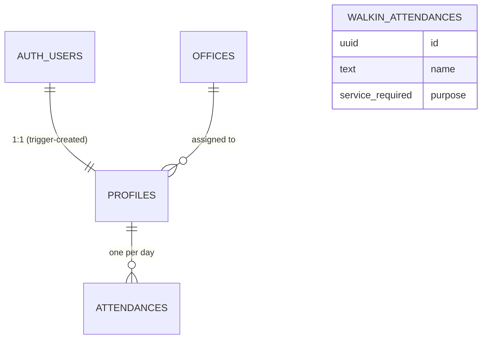

# PPESO CLIENT ATTENDANCE — Database Agent

> **Purpose**: This document is the authoritative reference for the PPESO Client Attendance database architecture.
> Any AI agent writing queries, creating types, or modifying schema-related code MUST follow these rules.

---

## 1. Database Overview

| Property            | Value                                                                  |
| ------------------- | ---------------------------------------------------------------------- |
| **Provider**        | Supabase (managed PostgreSQL 17)                                        |
| **Project**         | `ppeso-client-attendance` — ref `otulzqszdvyzebetiqkn` (ap-southeast-1) |
| **Schemas**         | 2 app schemas: `public` (`profiles`, `offices`, `directories`), `core` (+ `private` for RLS helpers, not exposed) |
| **Type Generation** | `npm run types:gen`                                                     |
| **Type File**       | [`src/types/database.types.ts`](../src/types/database.types.ts) (DO NOT EDIT) |
| **Migrations**      | [`supabase/migrations/`](../supabase/migrations) — source of truth for schema + RLS |
| **Security**        | RLS enabled on every table; `anon` has no table access                  |

---

## 2. Schema Architecture

```
┌──────────────────────────────────────────────────────────────┐
│                     PostgreSQL Instance                       │
│                                                               │
│  ┌──────────────────┐   ┌──────────────────────┐   ┌────────┐ │
│  │      public       │   │         core          │   │private │ │
│  │  identity & org   │   │ attendance & visits   │   │  RLS   │ │
│  │  profiles         │◄──│  attendances          │   │helpers │ │
│  │  offices          │   │  walkin_attendances   │   │(no API)│ │
│  └──────────────────┘   └──────────────────────┘   └────────┘ │
│            ▲                                                  │
│       auth.users (Supabase Auth, 1:1 with profiles)           │
└──────────────────────────────────────────────────────────────┘
```

---

## 3. Schema: `public` — Identity & Organisation

### `offices`

| Column       | Type          | Constraints              |
| ------------ | ------------- | ------------------------ |
| `id`         | `uuid`        | PK, `gen_random_uuid()`  |
| `code`       | `text`        | UNIQUE, nullable         |
| `directory_id` | `uuid`       | FK → `directories(id)` ON DELETE SET NULL; unique when set. The office head shown in the app comes from here |
| `name`       | `text`        | NOT NULL                 |
| `is_active`  | `boolean`     | default `true`           |
| `created_at` | `timestamptz` | default `now()`          |
| `updated_at` | `timestamptz` | default `now()` (set by the app on update) |

### `directories`

Office directory: each office's name, code and head (migration `20261113000200_directories.sql`).

| Column        | Type          | Constraints                                         |
| ------------- | ------------- | --------------------------------------------------- |
| `id`          | `uuid`        | PK, `gen_random_uuid()`                              |
| `office_name` | `text`        | NOT NULL; indexed                                    |
| `office_code` | `text`        | UNIQUE, nullable                                     |
| `office_head` | `text`        | nullable — a person's name (PRIVACY.md §2)           |
| `status`      | `text`        | NOT NULL, default `'active'`, CHECK `in ('active', 'inactive')`; trimmed + lowercased by `trg_normalize_directory_status` (CSV `Active` works) |
| `created_at`  | `timestamptz` | NOT NULL, default `now()`                            |

### `holidays`

Set by admins on the Calendar page (migration `20261113000700_holidays.sql`).

| Column         | Type          | Constraints                         |
| -------------- | ------------- | ----------------------------------- |
| `id`           | `uuid`        | PK                                  |
| `holiday_date` | `date`        | NOT NULL, UNIQUE                    |
| `name`         | `text`        | NOT NULL, not blank                 |
| `created_at` / `updated_at` | `timestamptz` | `updated_at` set by `trg_touch_holiday_updated_at` |

Effects: a weekday holiday with no punches prints its name across that DTR row (`dtrHelper.buildDtrRows`), and
`core.flag_daily_absences` does nothing on a holiday.

### `profiles`

One row per auth user. Created by the `on_auth_user_created` trigger — never inserted by the client.

| Column       | Type               | Constraints                                         |
| ------------ | ------------------ | --------------------------------------------------- |
| `id`         | `uuid`             | PK, FK → `auth.users(id)` ON DELETE CASCADE          |
| `firstname`  | `text`             | NOT NULL                                            |
| `middlename` | `text`             | nullable                                            |
| `lastname`   | `text`             | NOT NULL                                            |
| `passcode`   | `text`             | UNIQUE, nullable — 6-digit kiosk code, auto-generated; **NULL for admins and supervisors** |
| `status`     | `profile_status`   | NOT NULL, default `'active'`                         |
| `position`   | `profile_position` | NOT NULL                                            |
| `role`       | `profile_roles`    | nullable, default `'beneficiary'`                    |
| `office_id`  | `uuid`             | FK → `offices(id)` ON DELETE SET NULL; indexed       |
| `funding`    | `text`             | nullable, CHECK `in ('DOLE', 'PGAS')` — GIP / TUPAD funding; picks the accomplishment report form. Admin-only (guard trigger) |
| `avatar_path` | `text`            | nullable — profile picture path in the private `avatars` bucket (`<user id>/<file>`); the user may only point it at their own folder (guard trigger) |
| `created_at` | `timestamptz`      | NOT NULL, default `now()`                            |
| `updated_at` | `timestamptz`      | set by `trg_guard_profile_update`                    |

### Public Enums

| Enum               | Values                                   |
| ------------------ | ---------------------------------------- |
| `profile_roles`    | `admin`, `beneficiary`, `supervisor`     |
| `profile_position` | `employee`, `gip`, `tupad`, `client`, `admin` |
| `profile_status`   | `active`, `inactive`, `pending`          |

Role ↔ position convention used by `userManagementService.createUser`: **`admin` → `admin`** (the only position with
admin access), `employee` / `gip` / `tupad` → `beneficiary`, `client` → no role. Supervisors are created with **Add Supervisor**
(User Management): the office's chief from `directories.office_head` becomes an `employee` with role `supervisor` for that
office (one per office), or an admin promotes someone in Edit User.
Migration `20261113000600` moved every existing admin account to the `admin` position.

---

## 4. Schema: `core` — Attendance & Walk-in Clients

### `attendances`

One row per profile per day (`unique_daily_attendance`).

| Column            | Type           | Constraints                                       |
| ----------------- | -------------- | ------------------------------------------------- |
| `id`              | `uuid`         | PK                                                |
| `profile_id`      | `uuid`         | NOT NULL, FK → `public.profiles(id)` ON DELETE CASCADE |
| `attendance_date` | `date`         | NOT NULL, default `current_date`; indexed          |
| `am_check_in` / `am_check_out` / `pm_check_in` / `pm_check_out` | `timestamptz` | nullable |
| `am_in_status` / `am_out_status` / `pm_in_status` / `pm_out_status` | `punch_status` | nullable |
| `created_at`      | `timestamptz`  | NOT NULL, default `now()`                          |

Constraint: `UNIQUE (profile_id, attendance_date)`.

### `walkin_attendances`

Walk-in client log (not linked to an account).

| Column           | Type               | Constraints                         |
| ---------------- | ------------------ | ----------------------------------- |
| `id`             | `uuid`             | PK                                  |
| `firstname` / `lastname` | `text`     | NOT NULL                            |
| `middlename`     | `text`             | nullable                            |
| `gender`         | `gender_type`      | NOT NULL, default `'not specified'` |
| `contact_number` | `text`             | nullable                            |
| `province` / `geographic` (municipality) / `barangay` / `purok` | `text` | NOT NULL |
| `purpose`        | `service_required` | NOT NULL, default `'others'`; indexed |
| `check_in`       | `timestamptz`      | NOT NULL, default `now()`; indexed DESC |
| `check_out`      | `timestamptz`      | nullable                            |
| `created_at`     | `timestamptz`      | NOT NULL, default `now()`           |

### `accomplishment_reports`

Accomplishment reports of GIP / TUPAD beneficiaries (migration `20261118000000_accomplishment_reports.sql`, ported from
vue-agsurjobs). One row per date range; one person's reports never overlap.

| Column | Type | Notes |
| ------ | ---- | ----- |
| `id` | `uuid` | PK |
| `profile_id` | `uuid` | NOT NULL, FK → `public.profiles(id)` ON DELETE CASCADE |
| `funding` | `text` | `DOLE` / `PGAS`, copied from the profile on insert (never from the client) |
| `period_start` / `period_end` | `date` | `period_end >= period_start`; start not after today (PHT) |
| `daily_entries` | `jsonb` | `[{ date, status: Worked\|Holiday\|Leave, entry }]` — weekdays of the period up to today |
| `activities` | `jsonb` | PGAS: `[{ activity, output, remarks }]` (≤ 50) |
| `designation`, `supervisor_name`, `approver_name`, `approver_position` | `text` | ≤ 150, printed on the form |
| `amount` / `amount_in_words` | `numeric(12,2)` / `text` | PGAS payment receipt |
| `status` | `text` | `Draft` → `Submitted` → `Reviewed`, or `Returned` (needs `review_remarks`) |
| `review_remarks`, `reviewed_by` (FK profiles, SET NULL), `reviewed_at`, `submitted_at`, `created_at`, `updated_at` | | Review stamps are set by the trigger |

`core.check_accomplishment_report()` (BEFORE INSERT/UPDATE, **SECURITY INVOKER**) validates what the owner writes
(funding, overlap, entries, submit completeness; saving a Returned report keeps it Returned) and lets a reviewer
(admin, or the supervisor of the person's office) change only `status` / `review_remarks`.

### `evaluation_questions`

Questions supervisors rate GIPs on, written by admins (migration `20261119000000_gip_evaluations.sql`).

| Column | Type | Notes |
| ------ | ---- | ----- |
| `id` | `uuid` | PK |
| `category` | `text` | `performance` / `attitude` |
| `question` | `text` | 3–500 chars, trimmed by `trg_touch_evaluation_question` |
| `sort_order` | `integer` | order within the category |
| `is_active` | `boolean` | only active questions are asked (and visible to supervisors) |
| `created_at` / `updated_at` | `timestamptz` | |

### `gip_evaluations`

A supervisor's monthly evaluation of an active GIP in their office. `UNIQUE (profile_id, period_month)`.

| Column | Type | Notes |
| ------ | ---- | ----- |
| `id` | `uuid` | PK |
| `profile_id` | `uuid` | NOT NULL, FK → `public.profiles(id)` ON DELETE CASCADE |
| `evaluator_id` | `uuid` | FK → profiles ON DELETE SET NULL; set to the caller by the trigger |
| `period_month` | `date` | first day of the month; the trigger sets the current month (PHT) on insert |
| `answers` | `jsonb` | `[{ question_id, category, question, rating 1–5 }]` — rebuilt by the trigger from the active questions (a copy of the text, so editing / deleting a question never changes it) |
| `performance_score` / `attitude_score` / `overall_score` | `numeric(3,2)` | averages, computed by the trigger |
| `remarks` | `text` | ≤ 1000 |
| `status` | `text` | `Draft` → `Submitted` (locked); submitting needs every active question rated |
| `submitted_at`, `created_at`, `updated_at` | `timestamptz` | |

`core.check_gip_evaluation()` (BEFORE INSERT/UPDATE, **SECURITY INVOKER**): only the supervisor of the GIP's office,
only active GIPs (`position = gip`), only the current month, no changes once Submitted.

### Core Enums

| Enum               | Values                                                        |
| ------------------ | ------------------------------------------------------------- |
| `punch_status`     | `ontime`, `late`, `early_out`, `absent`                       |
| `gender_type`      | `male`, `female`, `not specified`                             |
| `service_required` | `gip`, `spes`, `job_start`, `ofw`, `cea`, `skills`, `others`  |

---

## 5. Functions, Triggers & Scheduled Jobs

| Object | Kind | What it does |
| ------ | ---- | ------------ |
| `public.handle_new_user()` | `AFTER INSERT ON auth.users` (`on_auth_user_created`), DEFINER | Creates the `profiles` row from signup metadata. **Never reads `role` from metadata.** |
| `public.set_profile_passcode()` | `BEFORE INSERT OR UPDATE OF role, passcode ON profiles`, DEFINER | Admin / supervisor role → passcode NULL; any other role → unique 6-digit passcode if missing |
| `public.guard_profile_update()` | `BEFORE UPDATE ON profiles` (`trg_guard_profile_update`), DEFINER | Non-admin API callers may change only their own name fields; sets `updated_at` |
| `public.admin_delete_user(uuid)` | DEFINER, RPC for `authenticated` | Admin-only (not self): deletes the `auth.users` row; profile and attendance cascade |
| `core.calculate_punch_status()` | `BEFORE INSERT OR UPDATE ON attendances` | 5-minute cooldown between punches (`'Already Recorded'`); fills statuses left null |
| `core.flag_daily_absences(date)` | DEFINER, called by pg_cron | Marks missing punches `absent` for active, non-client profiles that use the kiosk (not admins / supervisors); skips dates in `public.holidays` |
| `private.user_role()`, `user_office_id()`, `is_admin()`, `is_supervisor()`, `supervises(uuid)` | DEFINER, `private` schema | RLS helpers (SECURITY.md §4.3) |

| pg_cron job | Schedule | Command |
| ----------- | -------- | ------- |
| `auto-flag-daily-absences` | `0 18 * * 1-5` (18:00 UTC = 02:00 PHT next day, Mon–Fri UTC) | `SELECT core.flag_daily_absences(CURRENT_DATE);` |

> [!IMPORTANT]
> Every function is `SET search_path = ''` and schema-qualifies every name. None of them is executable by `anon` or
> `authenticated` through the API (except the `private` helpers, which PostgREST does not expose).

---

## 6. Row Level Security Summary

Full rules in SECURITY.md §4. Policy names are prefixed with the table (`"attendances: admin insert"`).

| Table                     | SELECT                                                  | INSERT / UPDATE / DELETE |
| ------------------------- | ------------------------------------------------------- | ------------------------ |
| `public.profiles`         | own row · admin all · supervisor same office            | insert: admin · update: own (names only) or admin · delete: admin, not self |
| `public.offices`          | any signed-in user                                      | admin                    |
| `public.directories`      | any signed-in user                                      | admin                    |
| `public.holidays`         | any signed-in user                                      | admin                    |
| `core.attendances`        | own rows · admin all · supervisor same office           | admin                    |
| `core.walkin_attendances` | admin, supervisor                                       | admin                    |
| `core.accomplishment_reports` | own · admin all · supervisor same office        | insert: own · update: own (not Reviewed) or reviewer (status/remarks only, trigger) · delete: own unreviewed, admin |
| `core.evaluation_questions` | admin all · supervisor active only                | admin |
| `core.gip_evaluations`    | admin all · supervisor same office (GIPs: none)         | insert: supervisor same office · update: supervisor, Draft only · delete: admin, supervisor own-office Draft |

---

## 7. Entity Relationship Diagram



`walkin_attendances` stands alone: walk-in clients have no account.

---

## 8. Type Generation & Usage

```bash
rtk npm run types:gen
```

```typescript
import type { Database } from '@/types/database.types'

type ProfileRow = Database['public']['Tables']['profiles']['Row']
type OfficeRow = Database['public']['Tables']['offices']['Row']
type AttendanceRow = Database['core']['Tables']['attendances']['Row']
type AttendanceUpdate = Database['core']['Tables']['attendances']['Update']
type WalkinInsert = Database['core']['Tables']['walkin_attendances']['Insert']

type ProfileRole = Database['public']['Enums']['profile_roles']
type PunchStatus = Database['core']['Enums']['punch_status']

// Client-only computed fields use intersections
type AttendanceRecord = AttendanceRow & { fullName: string; officeName: string | null }

// Partial projections use Pick
type ProfileSummary = Pick<ProfileRow, 'id' | 'firstname' | 'lastname' | 'role' | 'status'>
```

> [!CAUTION]
> 1. **NEVER manually edit `database.types.ts`.**
> 2. **NEVER hand-write DB column types** — derive from `Database[...]`.
> 3. Enum option lists in helpers (e.g. `PURPOSE_OPTIONS`) must cover every value of the enum.
> 4. After schema changes, always run `npm run types:gen`.

---

## 9. Database Migrations

| File | Purpose |
| ---- | ------- |
| `20261113000000_baseline_schema.sql` | Idempotent capture of the existing schema: enums, 4 tables, constraints, indexes, triggers, functions |
| `20261113000100_rls_policies.sql` | Drops all old policies; `private` helpers; grants; RLS policies; profile guard trigger; function privileges |
| `20261113000200_directories.sql` | `public.directories` table + RLS (signed-in read, admin write) |
| `20261113000300_directories_normalize_status.sql` | Normalises `directories.status` case before the CHECK runs |
| `20261113000400_offices_directory_link.sql` | `offices.directory_id` → `directories` (one office per directory entry) |
| `20261113000500_profile_position_admin.sql` | Adds `admin` to `profile_position` |
| `20261113000600_admins_to_admin_position.sql` | Sets `position = admin` for every `role = admin` account |
| `20261113000700_holidays.sql` | `public.holidays` + RLS; `flag_daily_absences` skips holidays |
| `20261113000800_passcode_only_for_kiosk_roles.sql` | Passcode nullable; none for admins / supervisors; absence flagging skips them |
| `20261113000900_admin_delete_user.sql` | `admin_delete_user()` — User Management deletes the login, not just the profile |
| `20261118000000_accomplishment_reports.sql` | `profiles.funding` (admin-only); `core.accomplishment_reports` + RLS + validation trigger |
| `20261118000100_accomplishment_reports_current_month.sql` | New reports (or changed dates) must fall within the current month (PHT); older reports keep their dates |
| `20261118000200_profile_photos.sql` | `profiles.avatar_path`; private Storage bucket `avatars` (JPG/PNG/WebP ≤ 5 MB) + storage.objects policies (own folder; admin read / delete) |
| `20261119000000_gip_evaluations.sql` | `core.evaluation_questions` (admin CRUD) + `core.gip_evaluations` (monthly supervisor evaluation of active GIPs) + RLS + `check_gip_evaluation` trigger |

> Migrations `0400`–`0900` were applied before being recorded; on 11/18/2026 they were marked applied with
> `supabase migration repair --status applied` (no SQL re-run).

### Workflow

```bash
# 1. Link once per machine (the CLI cache in supabase/.temp is not committed)
rtk npx supabase link --project-ref otulzqszdvyzebetiqkn

# 2. Write supabase/migrations/<yyyymmddHHMMSS>_<snake_name>.sql

# 3. Preview, then apply
rtk npx supabase db push --linked --dry-run
rtk npx supabase db push --linked

# 4. Regenerate types
rtk npm run types:gen
```

Read-only inspection without Docker: `rtk npx supabase db query --linked "select ..."`.

### Rules

> [!CAUTION]
> 1. **Every schema, RLS, grant, trigger or function change is a new migration.** Never change the database from the
>    dashboard SQL editor without capturing it in a migration.
> 2. **Never edit or delete an applied migration** — write a new one.
> 3. **Migrations must be safe on live data**: `create ... if not exists`, `create or replace`, `drop policy if exists`.
>    Never `drop table` / `truncate` a table that holds records without explicit user approval.
> 4. **Every new table** ships in the same migration with: `enable row level security`, policies for each command,
>    `revoke all ... from anon`, explicit `grant select, insert, update, delete ... to authenticated`, and indexes for
>    its foreign keys and filter columns.
> 5. **Every new function** is `SET search_path = ''`; `SECURITY DEFINER` only when it must bypass RLS, and then
>    `revoke execute ... from public, anon, authenticated` unless the API must call it.
> 6. Pushing to the live project is outward-facing: dry-run first and tell the user what will change.
> 7. Verify RLS after a push by impersonating each role inside a rolled-back transaction:
>    ```sql
>    begin;
>    select set_config('request.jwt.claims', '{"sub":"<profile-id>","role":"authenticated"}', true);
>    set local role authenticated;
>    select count(*) from core.attendances;
>    rollback;
>    ```

---

## 10. Known Schema Quirks

> [!WARNING]
> 1. **Split schemas**: identity tables are in `public`, attendance tables in `core`. Services that fall back to
>    `public.attendances` / `public.walkin_attendances` target tables that do not exist (BACKEND.md §4).
> 2. **`walkin_attendances.geographic`** holds the city/municipality name — not coordinates.
> 3. **Time zone**: the database runs in UTC. `core.calculate_punch_status()` compares `::time` in UTC, so its fallback
>    statuses (only used when the client sends `null`) are 8 hours off for Philippine time. The kiosk computes the status
>    client-side (`kioskhelper.calculatePunchStatus`) and sends it, so the trigger normally doesn't decide.
> 4. **`attendance_date`** defaults to `current_date` in UTC; the kiosk always sends the local (PHT) date explicitly.
>    Always pass `attendance_date` from `getLocalDateString()` — never rely on the default.
> 5. **pg_cron runs in UTC** — `0 18 * * 1-5` fires at 02:00 PHT the next morning and flags the working day that just
>    ended (`CURRENT_DATE` in UTC is still that day). Mon–Fri PHT days are covered.
> 6. **`profiles.role` is nullable** (`client` position accounts have none); the router sends a null role to `/login`.
> 7. **`core.attendances` is not in the `supabase_realtime` publication** (BACKEND.md §9).
> 8. **Delete accounts with `admin_delete_user()`**, never `delete from profiles`: deleting only the profile leaves the
>    `auth.users` login behind. Deleting the auth user cascades to the profile and its attendance rows.
